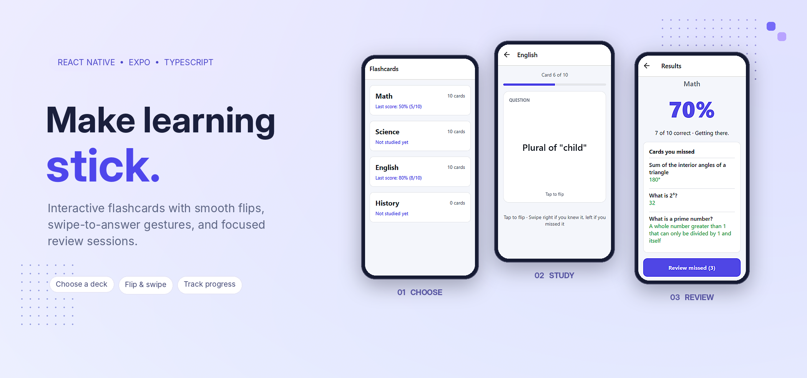
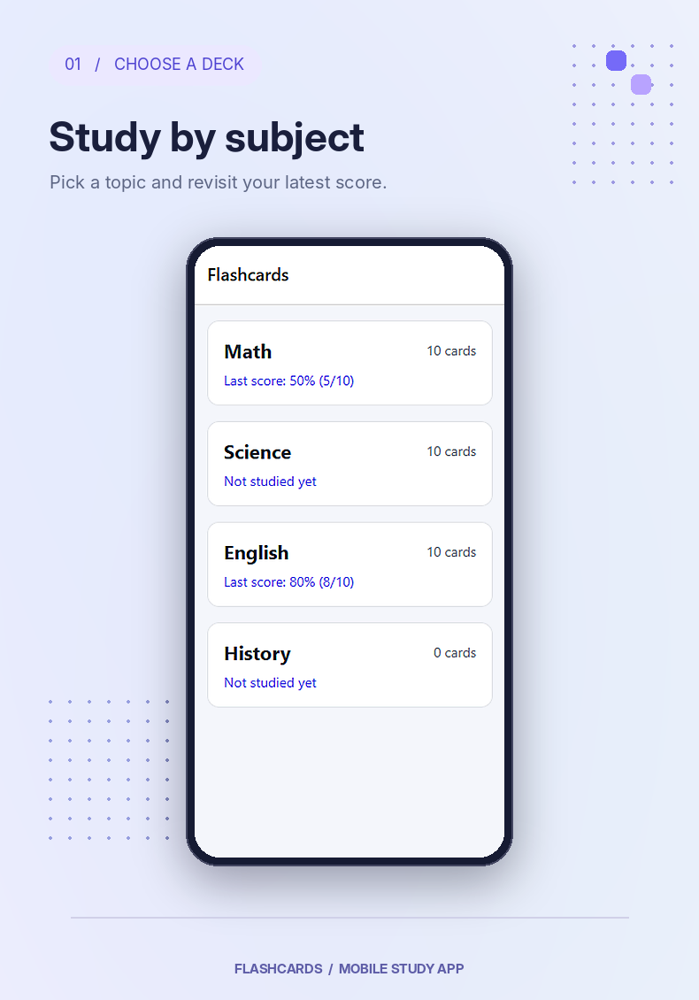
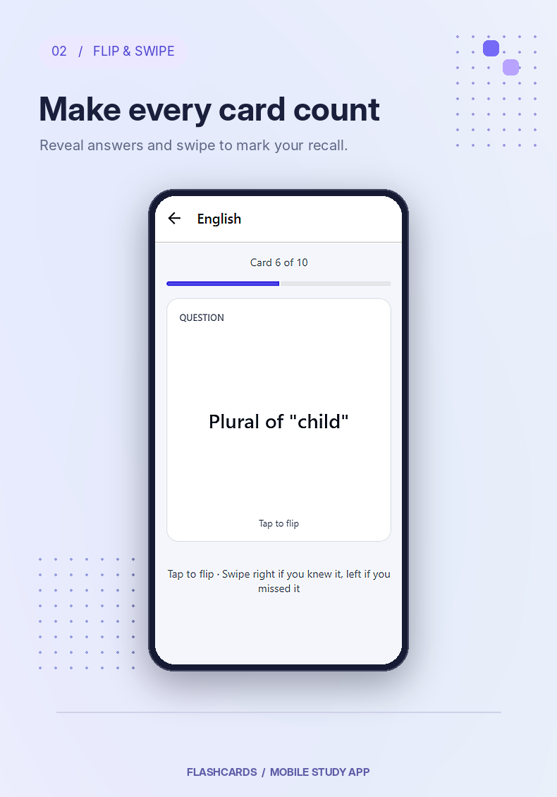
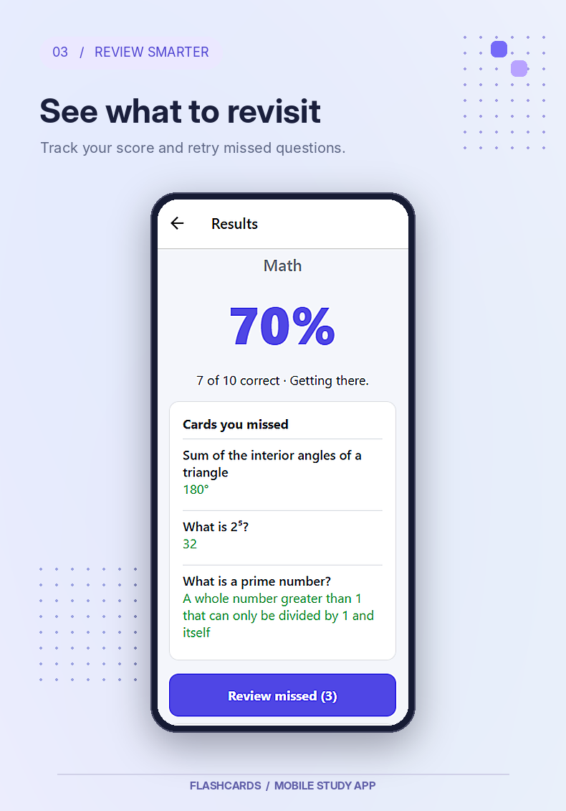

<div align="center">

# Flashcards App

**Flip a card. Test your recall. Review what matters.**

A lightweight flashcard study app built with **React Native, Expo, and TypeScript**, featuring 3D flip animations, swipe gestures, subject-based decks, and locally saved results.



**React Native** · **Expo SDK 57** · **TypeScript** · **Reanimated** · **Gesture Handler**

</div>

## App Preview

Real screenshots of the app, presented with a consistent purple visual theme.

| Choose a subject | Flip & swipe | Review your results |
| :---: | :---: | :---: |
|  |  |  |
| Browse decks and see your last score. | Tap to reveal the answer and swipe to respond. | See your score and retry the cards you missed. |

## Features

- **Subject-based decks:** Math, Science, and English each have 10 ready-to-study flashcards.
- **Animated card flips:** Tap a card to reveal the answer with a smooth 3D flip transition.
- **Swipe gestures:** Swipe **right** for **Got it** and **left** for **Missed it**; on-screen answer buttons are also available.
- **Shuffled study sessions:** Cards are randomized when you start studying.
- **Progress tracking:** Follow your current card number and progress bar throughout each session.
- **Session results:** See a percentage score, correct-answer count, and a list of missed cards.
- **Focused revision:** Review just the missed cards, or start the full deck again.
- **Offline, local progress:** The latest completed full-deck score for each subject is stored on your device.

> **Current content:** History is included as an empty placeholder deck (0 cards). The available study content is Math, Science, and English.

## Built With

| Technology | What it does |
| --- | --- |
| React Native | Builds the mobile interface |
| Expo (SDK 57) | Provides the development environment and tooling |
| TypeScript | Adds static types and safer code |
| React Navigation | Navigates between the deck, study, and results screens |
| React Native Reanimated | Drives the animated card flip and card movement |
| React Native Gesture Handler | Handles tap and swipe interactions |
| AsyncStorage | Persists completed study scores locally |

## How It Works

1. **Choose a subject.** Start with Math, Science, or English.
2. **Read the prompt.** View the question on the front of a card.
3. **Flip to reveal.** Tap to see the answer on the back.
4. **Mark your answer.** Swipe right if you knew it or left if you missed it.
5. **Check your results.** See your score and the answers you missed.
6. **Review or restart.** Focus on missed cards or study the full deck again.

## Project Structure

```text
Flashcards-App/
├── assets/                    # App assets
├── docs/
│   └── images/                # README artwork and screenshots
├── src/
│   ├── components/            # Flip and swipe components
│   ├── data/                  # Card and deck content
│   ├── navigation/            # Typed navigation routes
│   ├── screens/               # Deck list, study, and results screens
│   ├── storage/               # Local progress persistence
│   ├── styles/                # Shared styling
│   ├── theme.ts               # Theme tokens
│   ├── types.ts               # App types
│   └── utils/                 # Shared helpers
├── App.tsx
├── app.json
├── index.ts
└── package.json
```

## Add Your Own Flashcards

Deck content is stored in [`src/data/decks.json`](src/data/decks.json). Add cards using the same format as the existing decks. For example:

```json
{
  "id": "new-subject",
  "title": "New Subject",
  "cards": [
    {
      "id": "new-subject-1",
      "front": "Your question here",
      "back": "Your answer here"
    }
  ]
}
```

Add the new deck object to the existing top-level array and give each deck and card a unique ID.

## Saved Progress

The app uses **AsyncStorage** to save the latest completed **full-deck** score for each subject on the device. Reviewing missed cards does not overwrite that full-deck score. No account or cloud sync is required.

---

<div align="center">

Developed by **[Rashed Abuodeh](https://github.com/rashedabuodeh)**

</div>
